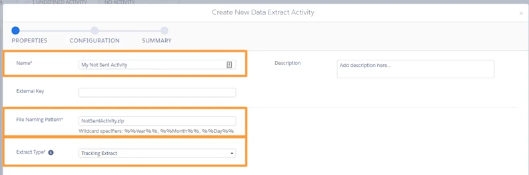
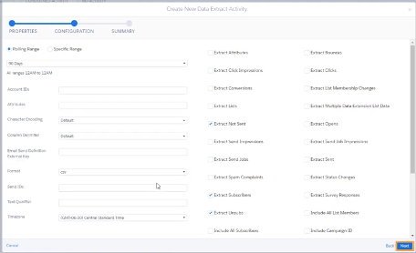
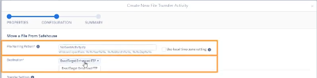
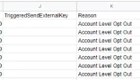
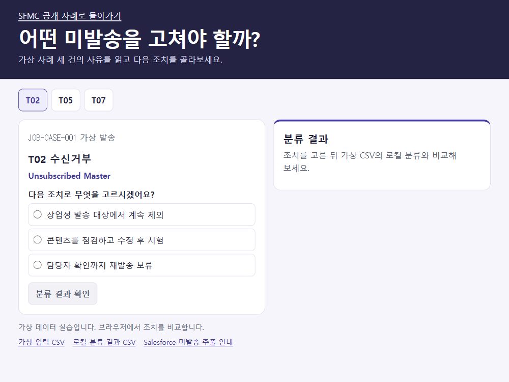
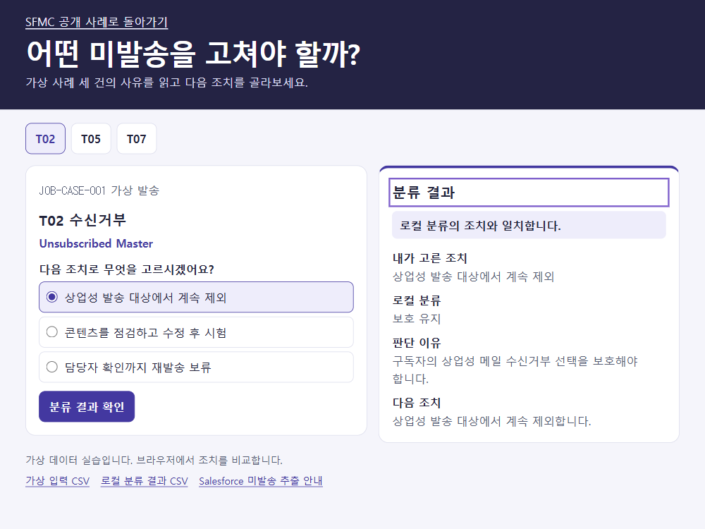
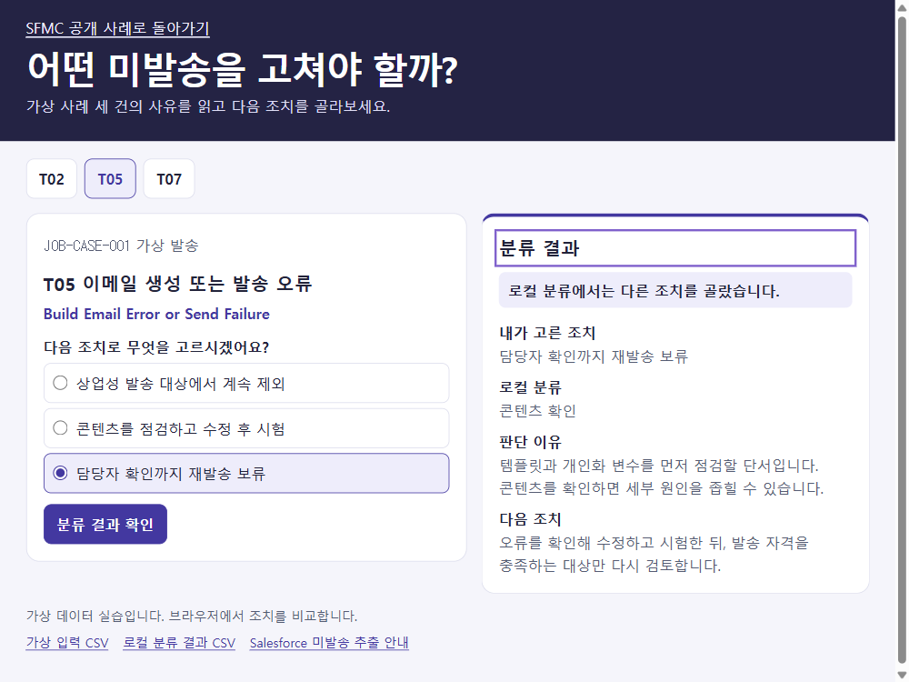
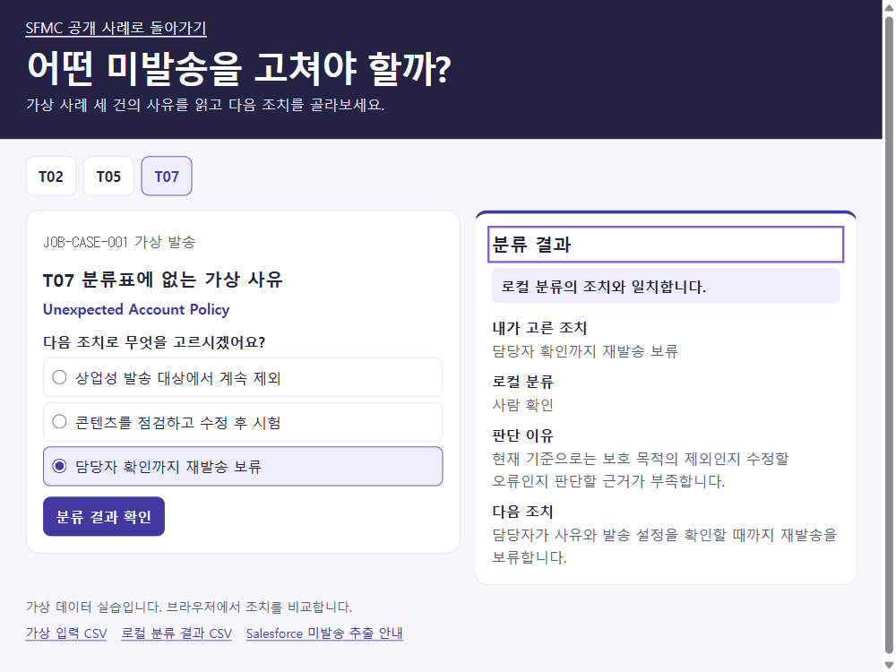

# SFMC에서 어떤 미발송을 고쳐야 할까?

[가상 사례 세 건으로 데모 열기](https://jhheo51-arch.github.io/jhheo51-arch/sfmc-not-sent-demo-20261123-v1.html)

미발송 사유를 읽고 다음 조치를 골라보세요. **분류 결과 확인**을 누르면 내 선택, 가상 CSV의 로컬 분류, 판단 이유와 다음 조치를 나란히 볼 수 있습니다.

## 문제 정의

Salesforce Marketing Cloud Engagement(SFMC) 채용 과제에서 발송 대상 수와 실제 발송 수가 어긋나는 상황을 다뤘습니다. 건수 차이만 보면 수신거부에 따른 제외와 수정할 수 있는 오류가 섞입니다. **저는 “발송 대상에 있었는데 메일이 나가지 않았다면, 어떤 건을 고치고 어떤 건은 그대로 둬야 할까?”를 진단의 중심 질문으로 정했습니다.** 운영자가 미발송 사유를 보고 제외 유지, 수정 검토, 보류 중 다음 조치를 정할 수 있게 하는 것이 목표였습니다.

## 문제 해결

Salesforce 공식 도움말, YouTube 영상, Mateusz Dąbrowski의 MCE 가이드로 독학했습니다. Salesforce 도움말에서 발송 건을 `JobID`로 특정하고, 미발송 추출 파일에서 `SubscriberKey`(구독자 식별자)와 `Reason`(미발송 사유)을 확인하는 방법을 찾았습니다. 이를 바탕으로 **보호나 정책에 따른 제외는 유지하고, 원인을 좁힐 수 있는 오류는 원천 데이터와 콘텐츠로 나눠 확인하며, 기준에 없는 사유는 판단을 보류**하도록 설계했습니다. [Not Sent 추출 안내](https://help.salesforce.com/s/articleView?id=000392619&language=en_US&type=1), [발송 문제 해결 안내](https://help.salesforce.com/s/articleView?id=000389518&language=en_US&type=1), [Mateusz Dąbrowski의 MCE 자료](https://mateuszdabrowski.pl/docs/#marketing-cloud-engagement)

### 가상 사례 세 건으로 판단 기준 확인

같은 가상 발송 `JOB-CASE-001`에서 후속 조치가 서로 다른 세 건을 골랐습니다.

| 가상 행과 미발송 사유 | 왜 그렇게 판단했나 | 로컬 분류와 다음 조치 |
|---|---|---|
| `T02` 수신거부 (`Unsubscribed Master`) | 상업성 메일 수신을 거부한 구독자의 선택을 보호해야 합니다. | **보호 유지.** 상업성 발송 대상에서 계속 제외합니다. |
| `T05` 이메일 생성 또는 발송 오류 (`Build Email Error or Send Failure`) | 템플릿과 개인화 변수를 먼저 점검할 단서입니다. 세부 원인은 해당 콘텐츠를 확인해야 좁힐 수 있습니다. | **콘텐츠 확인.** 오류가 확인되면 수정하고 시험한 뒤, 발송 자격을 충족하는 대상만 다시 검토합니다. |
| `T07` 분류표에 없는 가상 사유 (`Unexpected Account Policy`) | 현재 기준으로는 보호 목적의 제외인지 수정할 오류인지 판단할 근거가 부족합니다. | **사람 확인.** 담당자가 사유와 발송 설정을 확인할 때까지 재발송을 보류합니다. |

가상 CSV 전체 8행 중 선택한 발송의 7행만 검토했습니다. 보호 유지 4건, 원천 확인 1건, 콘텐츠 확인 1건, 사람 확인 1건이었고, 자동 재발송으로 표시된 행은 0건이었습니다. [가상 입력](not_sent_demo/sample_not_sent.csv), [행별 결과](not_sent_demo/results/reviewed_rows.csv), [분류 결과 JSON](not_sent_demo/results/summary.json)

## 결과 검토

2026년 11월 23일 로컬에서 자동 검사 **4개가 모두 통과**했습니다. 가상 CSV를 다시 분류해 대표 세 건과 공개 CSV 및 JSON의 값도 대조했습니다. [자동 검사 코드](not_sent_demo/test_not_sent_review.py), [실행 방법](not_sent_demo/README.md)

| 자동 검사에서 확인한 조건 | 결과 |
|---|---|
| 보호 대상과 처음 보는 사유에 재발송이 지정되지 않는가? | 보호 유지 4건을 확인했습니다. 분류표 밖 사유는 사람 확인으로 남았고, 검토한 7건 모두 자동 재발송 표시가 없었습니다. |
| 다른 발송 건이 검토 결과에 섞이지 않는가? | 선택한 `JobID`의 행만 반환했고, 없는 `JobID`를 요청하면 오류로 중단했습니다. |
| 같은 발송의 구독자가 두 번 집계되지 않는가? | 같은 `JobID`에 동일한 `SubscriberKey`가 반복되면 오류로 중단했습니다. |
| 미발송 사유가 없는 형식의 파일을 처리하지 않는가? | 필수 열 `Reason`이 빠지면 오류로 중단했습니다. |

### 사용 제한

검증 범위는 가상 입력에 대한 사유 분류와 결과 저장입니다. 실제 SFMC 계정 설정, 발송과 운영 효과는 미검증입니다.

### 앞으로 추진

허가받은 테스트 계정에서 개인정보가 없는 시험 발송의 추출 파일을 확보하면, 먼저 계정별 사유에 대한 기대 분류를 기록합니다. 그다음 실제 추출 결과를 대조해 보호 대상이 제외로 유지되고 수정 후보만 후속 검토로 넘어가는지 확인합니다. 사유 분류가 다르면 기준을 고친 뒤 같은 입력으로 다시 검증합니다.

## Salesforce 공식 Not Sent 추출 화면

Salesforce Support의 공식 시연에서 확인할 영역만 발췌했습니다. 설정에서 결과 파일의 사유를 확인하기까지 이어지는 순서입니다. [Salesforce 공식 추출 가이드](https://help.salesforce.com/s/articleView?id=000392619&language=en_US&type=1), [Salesforce Support 시연 원본](https://www.youtube.com/watch?v=uzKdG24ctCs)

### 추출 유형과 파일 이름

Automation Studio에서 Data Extract Activity를 만들 때 `Extract Type`이 **Tracking Extract**인지 확인합니다. `File Naming Pattern`은 다음 파일 전송 단계에서 같은 파일을 찾는 데 쓰입니다. [Salesforce Support 영상 1:00](https://www.youtube.com/watch?v=uzKdG24ctCs&t=60s)

### 미발송 추출 옵션과 기간

설정에서 **Extract Not Sent**가 선택됐는지 확인합니다. 조회 기간은 조사할 발송이 포함되는 범위인지 대조합니다. 영상에서는 `Rolling Range`를 보여 줍니다. [Salesforce Support 영상 1:50](https://www.youtube.com/watch?v=uzKdG24ctCs&t=110s)

### 추출 파일 전송

`Move a File From Safehouse`에서 추출 단계와 같은 파일 이름 패턴을 쓰는지, `Destination`이 파일을 받을 위치인지 확인합니다. [Salesforce Support 영상 2:50](https://www.youtube.com/watch?v=uzKdG24ctCs&t=170s)

### 결과 파일의 미발송 사유

`NotSent.csv`에서 `SubscriberKey`로 대상 행을 찾고 `Reason`으로 미발송 사유를 확인합니다. 발췌 화면에는 `Reason`의 **Account Level Opt Out** 예시가 보입니다. [Salesforce Support 영상 3:56](https://www.youtube.com/watch?v=uzKdG24ctCs&t=236s), [Salesforce 공식 추출 가이드](https://help.salesforce.com/s/articleView?id=000392619&language=en_US&type=1)

## 가상 데모 화면

아래 네 이미지는 2026년 11월 23일 이 사례의 데모를 브라우저에서 실행해 직접 캡처했습니다. 화면에 표시된 사유와 분류는 가상 입력과 공개 로컬 결과를 사용합니다. [데모 원본](https://jhheo51-arch.github.io/jhheo51-arch/sfmc-not-sent-demo-20261123-v1.html), [가상 입력 CSV](not_sent_demo/sample_not_sent.csv), [로컬 분류 결과 CSV](not_sent_demo/results/reviewed_rows.csv)

### 조치 선택 전

가상 행을 선택하면 미발송 사유와 세 가지 조치가 보입니다.

### T02 수신거부

상업성 발송에서 계속 제외를 선택하면 로컬 분류도 보호 유지임을 확인할 수 있습니다.

### T05 이메일 생성 또는 발송 오류

재발송 보류를 고른 예시입니다. 로컬 분류는 콘텐츠 확인이며, 템플릿과 개인화 변수를 먼저 점검하는 이유를 보여 줍니다.

### T07 분류표에 없는 가상 사유

사유를 판단할 근거가 부족할 때는 담당자 확인까지 재발송을 보류합니다.

과제에서 함께 점검한 항목

| 확인할 질문 | 다시 정한 판단 기준 |
|---|---|
| 제목 A/B 테스트의 승자를 열람률로 정해도 될까? | Apple Mail의 개인정보 보호 기능이 열람 수치에 영향을 줄 수 있습니다. 클릭을 확인하고, 예약이나 방문을 목표로 삼았다면 해당 행동 데이터를 따로 확인합니다. [Salesforce 열람 지표 안내](https://help.salesforce.com/s/articleView?id=sf.mc_jb_marketing_cloud_email_privacy.htm&language=en_US&type=5) |
| 접속 기록은 필요한 기간만큼 남아 있을까? | 공식 보관 기간은 Basic 30일, Advanced 60일입니다. 더 긴 기간이 필요하면 정기 추출의 누락 여부와 파일 접근 권한을 확인합니다. [Salesforce Audit Trail](https://help.salesforce.com/s/articleView?id=mc_overview_audit_trail.htm&language=en_US&type=5) |
| 최근 7일 기록으로 365일 비활동을 판단할 수 있을까? | 초안에서 조회 기간과 판정 기간이 어긋났습니다. 시스템 Data View의 180일 보관 범위를 기준으로 장기 이력과 원천의 Contact Key를 대조합니다. 삭제 후보 검토에는 보호 대상, 재동기화와 승인 여부를 포함합니다. [Salesforce 데이터 보관 한도](https://help.salesforce.com/s/articleView?id=mktg.mc_overview_limits_data_retention.htm&language=en_US&type=5) |

